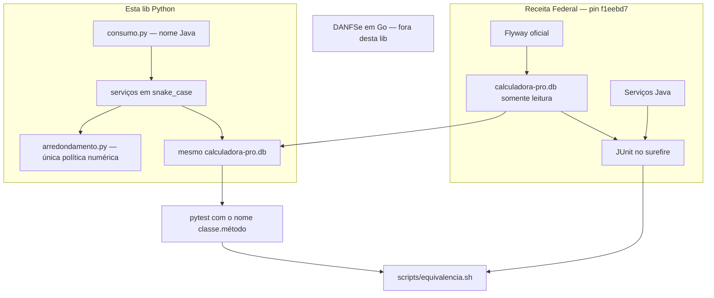

# calculadora-rtc-regime-regular

Cálculo de CBS, IBS e Imposto Seletivo do regime regular, em Python. É uma releitura da calculadora Java da Receita Federal, validada contra a suíte de testes dela no commit pinado. Não é um fork: o código Java não entra neste repositório.

**Nossas** (esta releitura em Python, MIT, Copyright (c) 2026 Garuso Cruz)

[](https://github.com/garusocruz/calculadora-rtc-regime-regular)
[](LICENSE)
[](#ultima-validacao)
[](cloudbuild.yaml)

**Do pin oficial** (calculadora Java da Receita Federal, commit `f1eebd7`, MIT, Copyright (c) 2026 Receita Federal do Brasil)

[](https://github.com/ReceitaFederal/calculadora-rtc-regime-regular/commit/f1eebd7ce3157423b1a6aaca7dc1d6c3395452c4)
[](LICENSE-RECEITA.md)
[](#ultima-validacao)

As duas coberturas medem unidades diferentes: a nossa conta sentenças Python (mínimo 80%) e a do pin conta linhas Java no JaCoCo (mínimo oficial 80%). O detalhe está em [Última validação](#ultima-validacao).

| | |
| --- | --- |
| Fonte oficial | [ReceitaFederal/calculadora-rtc-regime-regular](https://github.com/ReceitaFederal/calculadora-rtc-regime-regular) |
| Commit pinado | [`f1eebd7ce3157423b1a6aaca7dc1d6c3395452c4`](https://github.com/ReceitaFederal/calculadora-rtc-regime-regular/commit/f1eebd7ce3157423b1a6aaca7dc1d6c3395452c4) |
| Licenças | [LICENSE](LICENSE) (nossa) e [LICENSE-RECEITA.md](LICENSE-RECEITA.md) (Receita, sobre o Java do pin) |

## Índice

- [Arquitetura](#arquitetura)
- [Equivalência](#equivalencia)
- [Última validação](#ultima-validacao)
- [Atualização do pin](#atualizacao-do-pin)
- [Instalação](#instalacao)
- [Consumo](#consumo)
- [Licença](#licenca)

## Fora do escopo

A lib não sobe API, não emite nota, não assina XML e não chama a Sefin. O controller, o MockMvc e o HTTP 400 ficam no Java. Quem consome chama o serviço, com o mesmo nome de método da classe Java, em `calculadora_rtc_regime_regular.consumo`. O PyPI recebe só a versão de produção, no merge da `main`.

O DANFSe também fica de fora. O PDF da NFS-e é o módulo Go `danfse-service`, em https://github.com/ReceitaFederal/calculadora-rtc-gerador-danfse, pin `8d79e6b2f7fad6375340afcb51c85ed370c64a14`.

<a id="arquitetura"></a>

## Arquitetura



O banco não é gerado pela lib. O script de equivalência baixa o pin, roda o Flyway oficial e grava `calculadora-pro.db`. A lib abre esse arquivo em modo somente leitura. O caminho entra por `CALC_DB`. Sem a variável, ela procura `calculadora/db/calculadora-pro.db` a partir do diretório corrente.

<a id="equivalencia"></a>

## Equivalência

O gancho `scripts/hooks/pre-push.sh` chama `scripts/equivalencia.sh`. A pull request para `main` dispara `calculadora-rtc-regime-regular-pr` e roda o mesmo script em `cloudbuild.yaml`. Esse build não publica. O merge dispara `calculadora-rtc-regime-regular-main`, repete a equivalência em `cloudbuild-prod.yaml` e publica no PyPI a versão do `pyproject.toml`. Se essa versão já estiver no PyPI, o build não publica de novo. Não há workflow do GitHub Actions. Os triggers ainda não estão aplicados.

```bash
export PATH="${HOME}/.local/bin:${HOME}/.asdf/shims:${PATH}"
cd libs/calculadora-rtc-regime-regular
bash scripts/hooks/pre-push.sh
```

O script só imprime `pre-push OK` quando todas as linhas abaixo passam.

| Gate | O que confere | Falha se |
| --- | --- | --- |
| Java 25 | `java -version` começa em 25 | a máquina está em outra versão |
| Pin | checkout `f1eebd7ce3157423b1a6aaca7dc1d6c3395452c4` | o clone não chega nesse commit |
| Flyway | `./mvnw flyway:migrate` com `flyway-pro.conf` | `calculadora-pro.db` não aparece |
| Surefire | `./mvnw test` no Java oficial | algum teste Java falha |
| Pytest | `python3 -m pytest` com cobertura mínima de 80% | a suíte Python falha ou a cobertura fica abaixo |
| Nome e resultado | cada caso Java do corte tem o mesmo `classe.método` e o mesmo estado no JUnit Python | falta nome ou o estado diverge |

O corte deixa de fora o que é HTTP: classe ou pacote com `Controller`, método `teste_controller*`, nome com `retorna400`, `Teste_LoteArredondamento` e `Teste_SerializacaoNaoAlteraNumero`. Esses dois últimos disparam o MockMvc e leem o JSON da resposta. A arquitetura entra no corte: só `arredondamento.py` arredonda, e esse arquivo é o mesmo byte a byte na lib do Simples.

O surefire grava o `@DisplayName` como `classname` e acrescenta `(Tipo)` no método parametrizado. O pytest grava a classe Java e o método. O script aceita esse par.

<a id="ultima-validacao"></a>

## Última validação

Data: 22 de novembro de 2026. Sem trigger do Cloud Build, a única verificação é o script local: o `scripts/hooks/pre-push.sh` completo, com saída salva em `.cache/pre-push.log`, terminou em `pre-push OK`.

| Checagem | Saída |
| --- | --- |
| Maven test | a suíte Java do pin passou |
| Pytest | 1758 passaram, 6 ignorados, 32,80 s |
| Cobertura Python | 93,82% de 6506 sentenças. O mínimo desta lib é 80% |
| Cobertura Java do pin | 86,70% de 5097 linhas (4419 cobertas). JaCoCo do `mvn test` daquele commit, sem a classe `*Application`, como no `pom.xml` oficial. O workflow oficial exige 80% de linhas |
| Java no corte daquele momento | 672 unitários, 344 e2e |
| Python no relatório | 3079 chaves |
| Sem par | 0 |
| Resultado diferente | 0 |
| Frase final | `Equivalência: a mesma suíte passou nas duas.` |

Depois desse log, os testes de arquitetura passaram a contar no corte. A comparação seguinte usou o surefire já gerado e um pytest novo, sem repetir o Maven: 1020 casos Java, 0 sem par, 0 com resultado diferente.

<a id="atualizacao-do-pin"></a>

## Atualização do pin

A Receita não aceita pull request externo. O acompanhamento é a inscrição no repositório oficial, em Watch, com Issues, Releases e Security alerts. Pull requests e Discussions ficam desligados.

Os três pins oficiais (regime regular, Simples e DANFSe) estão em `lynko-workspace/initiatives/faturae/receita-rtc-pins.json`, no repositório interno da Lynko. O deste repositório também é o padrão `OFICIAL_SHA` de `scripts/equivalencia.sh`.

Quando sai um release, um alerta de segurança ou uma issue que muda regra:

1. Ler o commit novo no repositório oficial.
2. Trocar o pin no `OFICIAL_SHA` e no JSON de pins.
3. Rodar `bash scripts/hooks/pre-push.sh`.
4. Cada nome que faltar é um serviço que o controller Java chama. Portar esse serviço. A fachada em `consumo.py` conserva a classe e o método Java. Por dentro, a função nova fica em snake_case.
5. Repetir o gancho até `pre-push OK`.
6. Igualar a versão do `pyproject.toml` à versão de produção e abrir a pull request para `main`. O merge publica só esse pacote no PyPI.

Não se recoloca esse cálculo em `backends/faturae`. Não se publica no Artifact Registry. Não se publica pacote de rc.

<a id="instalacao"></a>

## Instalação

Python 3.12 ou superior. Dependência de runtime: `lxml`.

```bash
cd libs/calculadora-rtc-regime-regular
./install.sh
```

O script cria o `.venv` na raiz (`cenv` se existir, senão `python3 -m venv`), ativa esse ambiente e roda `poetry install --with dev`. Em outro shell: `source .venv/bin/activate`.

O `calculadora-pro.db` vem do Flyway oficial. O gancho deixa o arquivo em `.cache/oficial/java/calculadora/db/calculadora-pro.db`.

```bash
export CALC_DB="$PWD/.cache/oficial/java/calculadora/db/calculadora-pro.db"
```

<a id="consumo"></a>

## Consumo

Importe a fachada. Não abra porta e não monte JSON de controller.

```python
import os

os.environ["CALC_DB"] = "/caminho/calculadora-pro.db"

from calculadora_rtc_regime_regular.consumo import CalculadoraService
from calculadora_rtc_regime_regular.observabilidade import operacao_from_json

operacao = operacao_from_json(payload)  # o mesmo objeto que o serviço Java recebe
roc = CalculadoraService().calcularTributos(operacao)
```

`payload` usa os nomes do JSON que o serviço Java já aceita (`dhFatoGerador`, itens, classificação). `operacao_from_json` só traduz esse documento para `OperacaoCalculadoraInput`.

Fachada em `consumo.py`:

| Classe | Método de entrada |
| --- | --- |
| `CalculadoraService` | `calcularTributos` |
| `ObservabilidadeService` | `processarOperacao` |
| `DadosAbertosService` | `consultarUfs`, `consultarMunicipiosPorSiglaUf`, situações, classificações, NCM, NBS, fundamentação, tipos de DFe |
| `PedagioService` | cálculo de pedágio do regime regular |
| `NfseService` | base, local da operação e indicador da NFS-e |
| `ComponentesBaseCalculoInput` | `setVProd`, `setVFrete` e os demais componentes, `getValor` |

Consulta que lê o banco, como `DadosAbertosService`, precisa de `CALC_DB`. Sem o arquivo, a chamada falha ao abrir o SQLite. O cálculo não cria alíquota: quem chama informa base, alíquota e tratamento, e recebe o mesmo número do Java naquele pin.

<a id="licenca"></a>

## Licença

O código Java oficial não é copiado para este git. A licença dele vale para a obra da Receita e fica reproduzida aqui para o aviso de copyright.

| Obra | Licença | Arquivo |
| --- | --- | --- |
| Esta releitura em Python | MIT, Copyright (c) 2026 Garuso Cruz | [LICENSE](LICENSE) |
| Calculadora Java da Receita Federal, commit `f1eebd7ce3157423b1a6aaca7dc1d6c3395452c4` | MIT, Copyright (c) 2026 Receita Federal do Brasil | [LICENSE-RECEITA.md](LICENSE-RECEITA.md) |

O texto MIT da Receita exige que o aviso de copyright e a permissão acompanhem cópias substanciais daquela obra. A releitura conserva esse aviso, e a licença desta lib continua sendo a MIT de Garuso Cruz.
